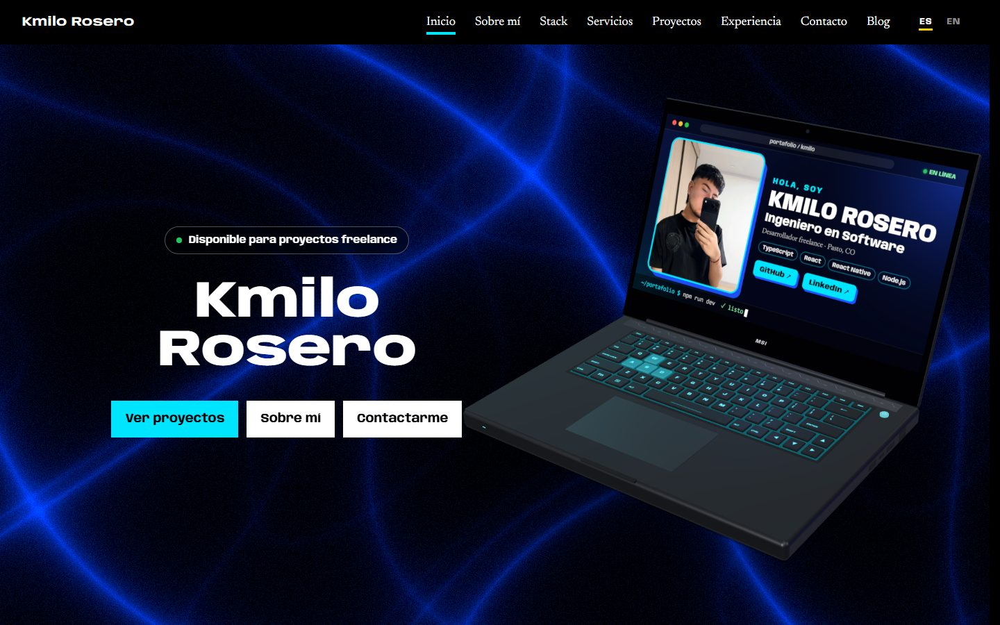
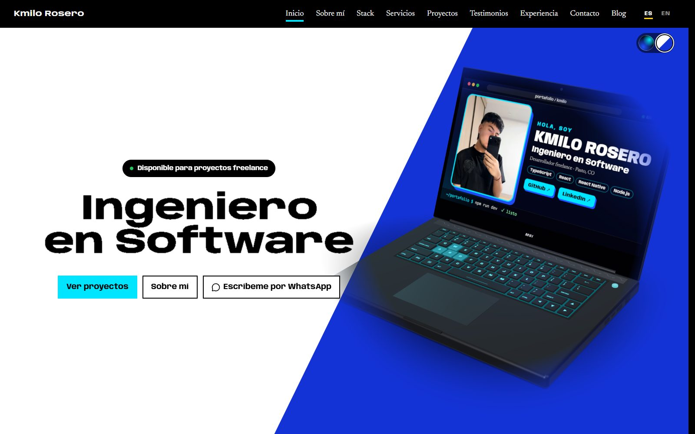
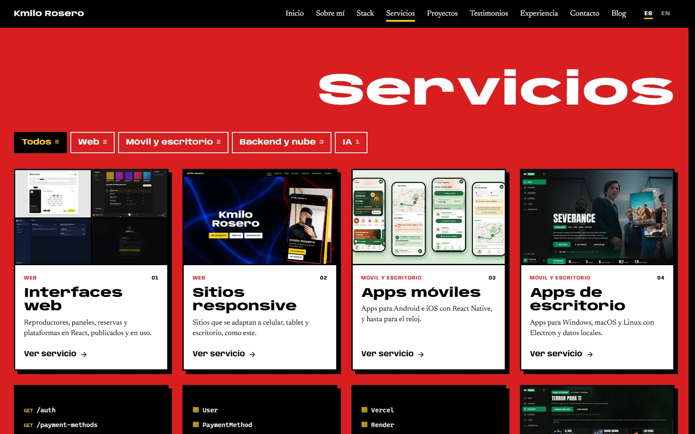
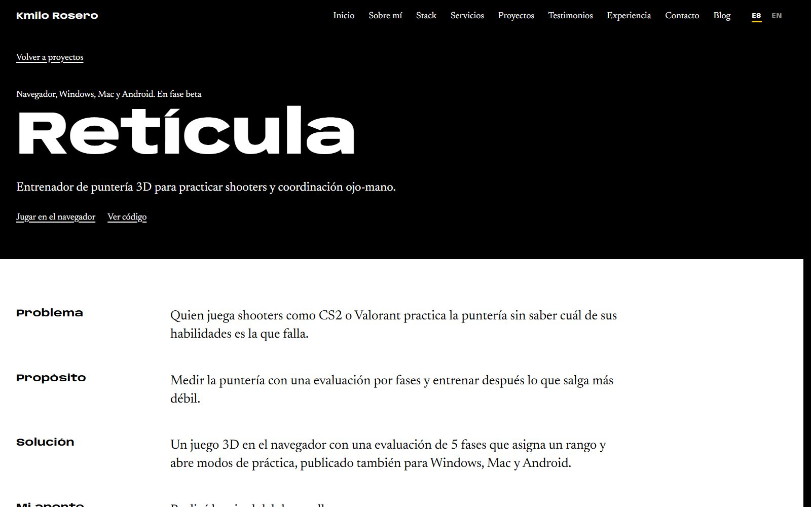
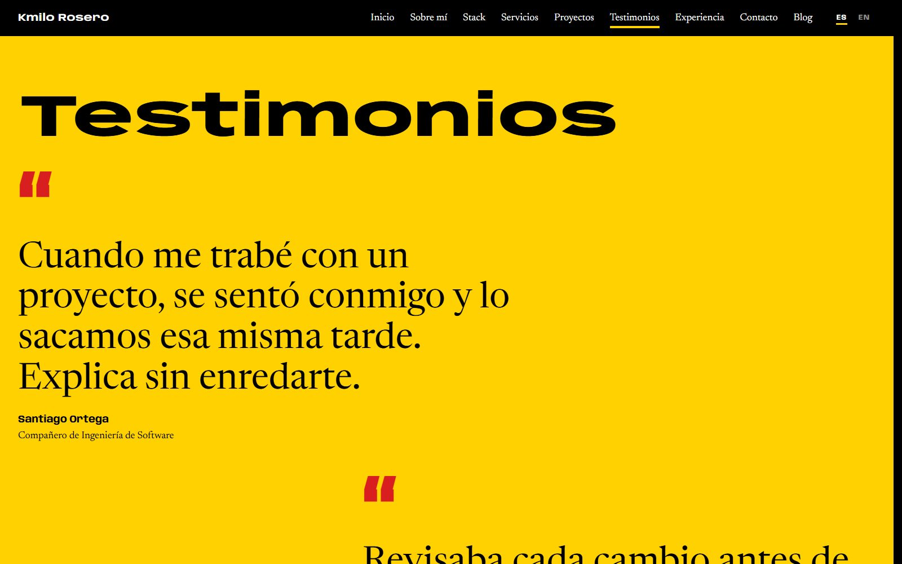
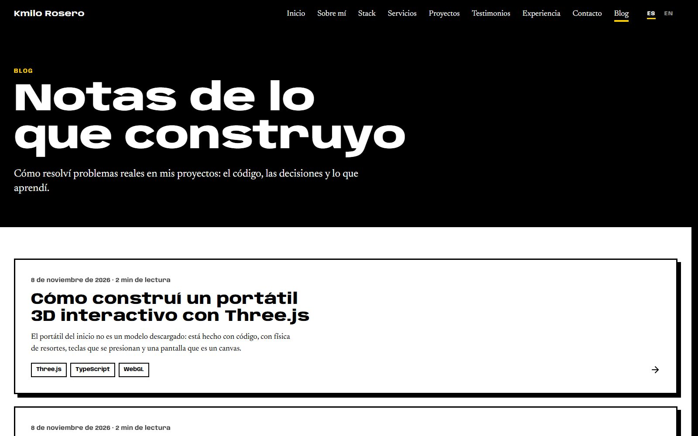
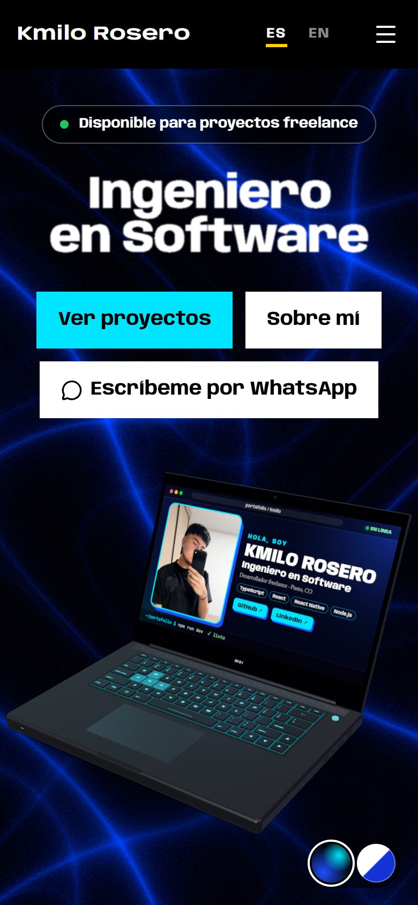
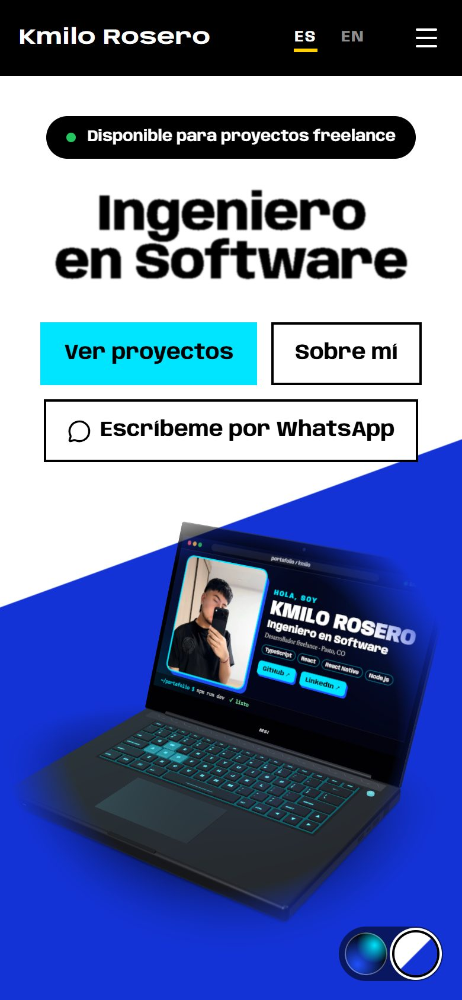

# Portafolio de Kmilo Rosero

Portafolio personal de Juan Camilo «Kmilo» Rosero, desarrollador freelance y estudiante de Ingeniería de Software en Pasto, Colombia. En español y en inglés.

**En vivo:** [i-m-nu.vercel.app](https://i-m-nu.vercel.app) · [English version](https://i-m-nu.vercel.app/en)

## Qué tiene

- **Dos fondos para el inicio:** el azul animado (un shader) o uno blanco y azul partido en diagonal. Se cambian con los dos botones de la esquina y la elección se recuerda.
- **Un portátil 3D interactivo** en el inicio, hecho con código en Three.js (sin modelos descargados). Puedes girarlo, abrir y cerrar la tapa, y presionar las teclas, o escribir con tu teclado y verlo en su pantalla. Su física usa resortes. Si no hay GPU, se muestra una foto del portátil.
- **Casos de estudio** de mis proyectos, con capturas reales, problema, solución y arquitectura.
- **Testimonios** de compañeros con los que he trabajado.
- **Un blog** con artículos técnicos sobre cómo está hecho este sitio.
- **Dos idiomas:** español en `/` e inglés en `/en`, con `hreflang`, sitemap y tarjetas para compartir en cada idioma.
- **Un formulario de contacto** que envía los mensajes a mi correo (con Resend).
- **SEO:** datos estructurados (Person, WebSite, SoftwareSourceCode, BlogPosting y BreadcrumbList).
- **Accesibilidad:** navegación por teclado y respeto por “reducir movimiento”.

## Capturas

| Inicio con el fondo animado | Inicio con el fondo blanco y azul |
| --- | --- |
|  |  |
| **Servicios** | **Caso de estudio (Retícula)** |
|  |  |
| **Testimonios** | **Blog** |
|  |  |

En el celular:

  
  

