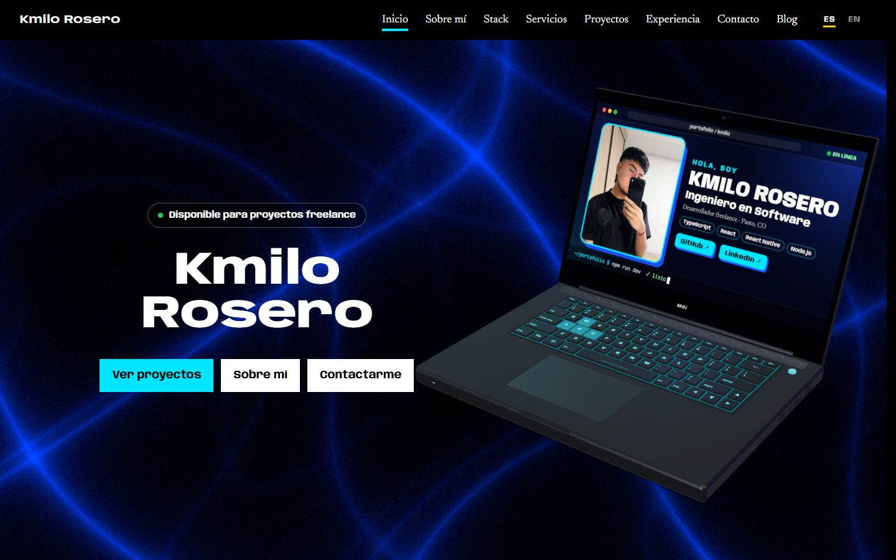

# Portafolio de Kmilo Rosero

Portafolio personal de Camilo «Kmilo» Rosero, desarrollador freelance y estudiante de Ingeniería de Software en Pasto, Colombia. En español y en inglés.

**En vivo:** [i-m-nu.vercel.app](https://i-m-nu.vercel.app) · [English version](https://i-m-nu.vercel.app/en)



## Qué tiene

- **Un portátil 3D interactivo** en el inicio, hecho con código en Three.js (sin modelos descargados). Puedes girarlo, abrir y cerrar la tapa, y presionar las teclas, o escribir con tu teclado y verlo en su pantalla. Su física usa resortes. Si no hay GPU, se muestra una foto del portátil.
- **Casos de estudio** de mis proyectos, con capturas reales, problema, solución y arquitectura.
- **Un blog** con artículos técnicos sobre cómo está hecho este sitio.
- **Dos idiomas:** español en `/` e inglés en `/en`, con `hreflang`, sitemap y tarjetas para compartir en cada idioma.
- **Un formulario de contacto** que envía los mensajes a mi correo (con Resend).
- **SEO:** datos estructurados (Person, WebSite, SoftwareSourceCode, BlogPosting y BreadcrumbList).
- **Accesibilidad:** navegación por teclado y respeto por “reducir movimiento”.

## Stack

Next.js 16 (App Router) · React 19 · TypeScript · Tailwind CSS 4 · Three.js · GSAP · Vercel (hosting, Analytics y Speed Insights).

## Cómo correrlo

Requiere Node.js 24.

```bash
npm ci
npm run dev          # http://localhost:3000
npm run build        # versión de producción
npm run typecheck    # TypeScript
npm run lint         # ESLint
npm test             # pruebas unitarias
npm run test:smoke   # recorre el sitio compilado (corre después de build)
```

### Variables de entorno (todas opcionales)

| Variable | Para qué |
| --- | --- |
| `RESEND_API_KEY` | Activa el formulario de contacto. Sin ella, el formulario no se muestra y queda el correo. |
| `CONTACT_TO_EMAIL` | A dónde llegan los mensajes (por defecto, mi correo). |
| `CONTACT_FROM_EMAIL` | Remitente; requiere un dominio verificado en Resend (por defecto, `onboarding@resend.dev`). |
| `GITHUB_TOKEN` | Sube el límite de la API de GitHub para las estadísticas de la sección Experiencia. |

## Cómo está organizado

```
src/
  app/(es)/          Rutas en español: /, /proyectos/[slug], /blog/[slug]
  app/(en)/en/       Las mismas rutas en inglés, bajo /en
  views/             Páginas compartidas por los dos idiomas
  sections/          Secciones del inicio
  components/        Componentes; hero/laptop3d/ es el portátil 3D
  data/              Contenido: proyectos, servicios, stack, experiencia, blog
  i18n/              Idiomas, rutas y textos de la interfaz
  utils/             Funciones puras, con sus pruebas al lado
tests/e2e/           Prueba de humo del sitio compilado
```

Cada texto del contenido lleva su traducción en la misma línea, `t('App móvil', 'Mobile app')`, así que es difícil olvidar una.

## Decisiones técnicas

- **Dos layouts raíz** (uno por idioma) para que `<html lang>` sea correcto sin un proxy ni librerías de i18n. [Más en el blog](https://i-m-nu.vercel.app/blog/sitio-bilingue-nextjs).
- **El 3D no bloquea la página:**
  - se inicia cuando el navegador está libre y se arma en pasos cortos;
  - los shaders compilan en segundo plano (`compileAsync` y `KHR_parallel_shader_compile`);
  - en equipos sin GPU se muestra una foto en su lugar.

  Así bajó de 8,6 a 2,4 segundos hasta estar listo. [Más en el blog](https://i-m-nu.vercel.app/blog/shaders-sin-bloquear).
- **Estático primero:** todas las páginas se generan al compilar. El inicio se regenera una vez al día con las estadísticas reales de GitHub.
- **Sin dependencias para lo que el navegador ya resuelve:** validación de formularios, fechas, animaciones con CSS (incluidas las ligadas al scroll).

## Calidad

Cada push a `main` pasa por integración continua (GitHub Actions):

1. typecheck, lint y pruebas unitarias;
2. build;
3. la prueba de humo, que levanta el sitio compilado y comprueba cada página del sitemap en los dos idiomas: que responda, su idioma, el canonical, la imagen para compartir y que los datos estructurados sean válidos.

---

## In English

Personal portfolio of Camilo “Kmilo” Rosero, a freelance developer and Software Engineering student in Pasto, Colombia. Live at [i-m-nu.vercel.app/en](https://i-m-nu.vercel.app/en).

Built with Next.js 16, React 19, TypeScript, Tailwind CSS 4 and Three.js, deployed on Vercel. It includes:

- an interactive 3D laptop made in code;
- case studies with real screenshots;
- a technical blog;
- a contact form;
- full Spanish/English support: two root layouts, `hreflang`, and per-language share cards.

Run it with `npm ci && npm run dev`. CI runs typecheck, lint, unit tests, a production build and a smoke test of every page in both languages.
